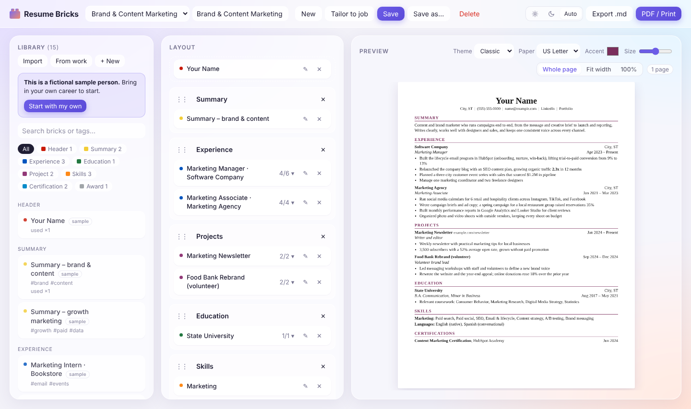
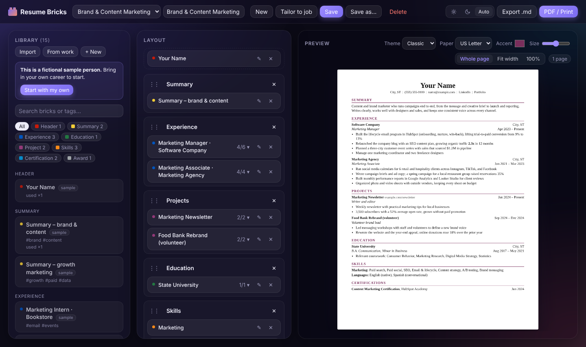
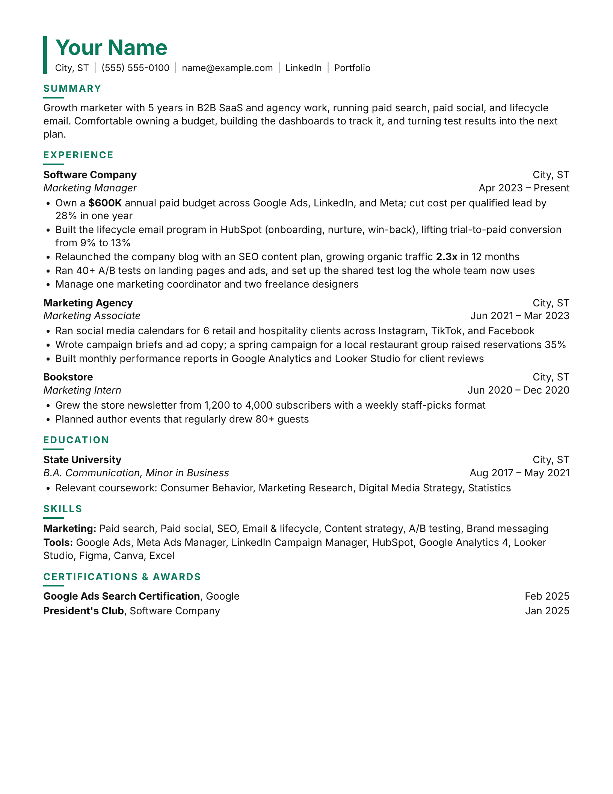
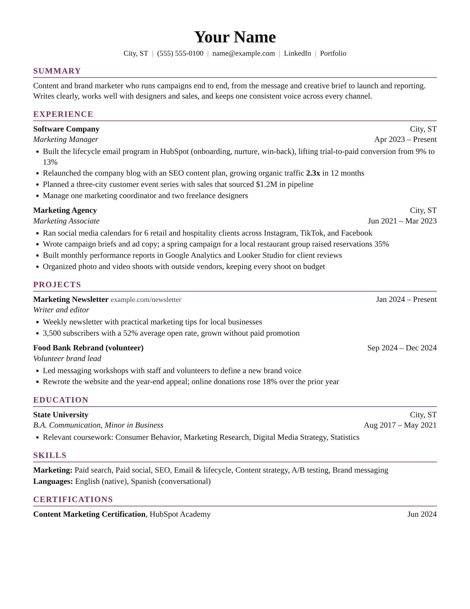

# 🧱 Resume Bricks

**Stock your career history as reusable bricks, then snap them together into a tailored resume for every application.**

[](LICENSE)


Write each job, project, degree, and skill group once. For each role you apply to, drag the right bricks into a layout, choose which bullets to show, and export a clean PDF. Everything runs on your own machine and is saved as plain YAML files you can read, edit, and version with Git.

**[▶ Use it in your browser](https://tsubasakoizumi1122.github.io/resume-bricks/app/)** (no install; your data stays in your browser) · [日本語はこちら ↓](#日本語)



<details><summary>Night mode</summary>



</details>

## Why

Most people keep one resume and rewrite it for every application, losing good bullets along the way. Resume Bricks treats your career as a library instead: every experience lives once as a brick, every rewording is kept, and each resume is just a selection and an order.

- **Write once, reuse everywhere.** One brick per job, project, degree or skill group.
- **Tailor in seconds.** Paste a job post and get a draft resume assembled from your own bricks.
- **No invented claims.** Tailoring only picks from what you've written, and shows which requirements you *don't* cover.
- **Your data stays yours.** Local server, plain YAML files, no account, no API key.

## Sample resumes

Two resumes built from the **same** bricks of a fictional marketer (`sample-data/`). Same career, different order, different summary, different bullets:

| Growth marketing (Modern) | Brand & content marketing (Classic) |
| --- | --- |
| [](docs/samples/growth-marketing.pdf) | [](docs/samples/brand-content-marketing.pdf) |
| Leads with paid budget, A/B tests and lifecycle email; adds the Google Ads certification and the tools list. | Leads with content and events; hides the paid-media bullets and adds a newsletter and a volunteer rebrand. |

Click an image for the PDF. Both open in the app on first run, so you can see exactly how they're put together.

## Use it in your browser

Open **<https://tsubasakoizumi1122.github.io/resume-bricks/app/>**. It's the same app, with nothing to install:

- Your bricks and resumes are saved **in that browser** (IndexedDB). PDF, Word and PowerPoint files are read in the browser too. Nothing is uploaded.
- Because the data lives in one browser, use **Download backup** at the top of the library now and then. The backup is a `.zip` laid out like `my-data/`, so **Restore** brings it back, and you can also unzip it into `my-data/` to switch to the local app.
- Clearing your browser's site data erases it, and it does not sync between browsers or devices. The local app below keeps everything as plain YAML files instead.

## Quick start (local app)

Requires [Node.js](https://nodejs.org/) 18.17 or newer.

```bash
git clone https://github.com/tsubasakoizumi1122/resume-bricks.git
cd resume-bricks
npm install
npm start
```

On a Mac you can also double-click `start-mac.command` instead of the last two commands.

Just want to look around? `npm run demo` (or double-click `start-demo-mac.command`) opens the app on a throwaway copy of the fictional sample data at <http://localhost:4322>. Your `my-data/` is never touched and nothing is kept.

Your browser opens at <http://localhost:4321>. On first run, a fictional sample person is copied into `my-data/` so you have something to play with. Replace it with your own bricks whenever you're ready.

## How it works

| Column | What it does |
| --- | --- |
| **Bricks** (left) | Your whole career library. Search, filter by type, create and edit bricks. |
| **Layout** (middle) | One resume: a header slot plus sections. Drag bricks in, reorder them, drag sections by `⋮⋮`, drag a brick back to the library to remove it. |
| **Preview** (right) | Live, print-accurate page with page-break guides and a page counter. |

### Features

- **Import your existing resume.** Click **Import** (or drop a PDF or .docx anywhere on the app). It is split into bricks by section; you review and uncheck anything you don't want, and it can also build a resume layout in the same order. Bricks already in your library are detected and reused. Files are read on your computer only.
- **Make bricks from your work.** Click **From work** and add reports, papers or slides (PDF, Word, PowerPoint), a GitHub link, a project folder, or notes. The app writes a prompt with your material and a few of your existing bullets as style examples; paste it into Claude, paste the reply back, and review the drafted bricks. The prompt tells Claude to use only facts from your material and to ask about anything it can't confirm. No API key needed.
- **Tailor to a job.** Click **Tailor to job**, paste a job post, and a new resume is assembled from your bricks: the best-matching summary, experience, projects, skills and certifications, with the most relevant bullets shown. With **Fit on one page** it trims the weakest bullets until it fits. A match report shows which terms your bricks cover and which requirements (Marketo, SQL…) none of them do, so you don't claim them. The matching knows the terms, tools and credentials of most fields, from software, data, design, sales, finance and HR to nursing, teaching, legal, trades and hospitality, so "PPC" counts as paid search and "RN" as nursing. Optionally copy a prompt to Claude to refine the pick; Claude chooses by brick id and bullet number only, so no new text gets written. Runs locally, no API key.
- **Bullet picking.** Click the `3/4 ▾` counter on a placed brick to choose which bullets appear *in this resume only*. Write every version of a bullet in the brick and pick per application.
- **Variants.** Open a brick and click **Duplicate** to make a reworded variant (for example, the same job pitched for growth vs. for brand roles).
- **Save.** `Save` (or Ctrl/⌘+S) writes the layout to `my-data/resumes/*.yaml`. `Save as…` creates a copy, so you can keep one resume per company.
- **Export.** **PDF / Print** opens the print dialog; choose "Save as PDF". **Export .md** downloads Markdown.
- **Resume look.** Classic or Modern, US Letter or A4, accent color, and text size.
- **Guided tour.** A quick tour opens the first time you visit. Replay it anytime with the **?** button at the top.
- **Night mode.** The sun / moon / Auto switch in the top bar. Auto follows your OS setting. PDFs always print on white.
- **Nothing is ever hard-deleted.** Deleted bricks and resumes move to `my-data/.trash/`.

## Your data

```
my-data/                 ← git-ignored: your personal data never gets committed
  blocks/                ← one YAML file per brick
    experience-software-company.yaml
  resumes/               ← one YAML file per resume layout
    growth-marketing.yaml
  .trash/
sample-data/             ← the fictional example that ships with the repo
```

A brick is just YAML, so hand-editing works too (click a filter chip or reload the page to see changes):

```yaml
type: experience
tags: [saas, growth, paid]
role: Marketing Manager
org: Software Company
location: City, ST
start: 2023-04        # YYYY-MM, or any text like "Summer 2025"
end: present
bullets:
  - Own a **$600K** annual paid budget across Google Ads, LinkedIn, and Meta
  - Built the lifecycle email program in HubSpot
```

Brick types: `header`, `summary`, `experience`, `education`, `project`, `skills`, `certification`, `award`, `custom`. Bullets support `**bold**` and `[links](https://…)`.

Want to keep your data in a private Git repo or a synced folder instead? Point the app at it:

```bash
RESUME_DATA=~/Dropbox/career-bricks npm start
```

### Privacy

- The server only listens on `127.0.0.1` and rejects requests from other hosts.
- Imported files are parsed locally; nothing is uploaded anywhere.
- The Claude features work by copy-paste: you see exactly what leaves your machine, and only when you paste it yourself.

## Options

| Env var | Default | Meaning |
| --- | --- | --- |
| `PORT` | `4321` | Port to serve on |
| `RESUME_DATA` | `./my-data` | Where your bricks and resumes live |
| `NO_OPEN` | unset | Set to `1` to skip opening the browser |
| `GITHUB_TOKEN` | unset | Optional. Lets **From work** read your private GitHub repos (otherwise add the local folder) |

## Development

```bash
npm run dev            # restarts on file changes
npm test               # node:test, no extra dependencies
npm run build:web      # docs/app/: the browser version (served by GitHub Pages)
npm run build:demo     # docs/demo.html: single-file demo with sample data, nothing saved
npm run build:samples  # docs/samples/*.pdf, *.png: the sample resumes above (needs Google Chrome)
```

No build step, no framework: a small Node server plus vanilla JavaScript in `public/`. Runtime dependencies: [`yaml`](https://www.npmjs.com/package/yaml), plus [`unpdf`](https://www.npmjs.com/package/unpdf), [`mammoth`](https://www.npmjs.com/package/mammoth) and [`jszip`](https://www.npmjs.com/package/jszip) for reading PDF, Word and PowerPoint files.

| File | Role |
| --- | --- |
| `server.js` | Local HTTP server and JSON API |
| `lib/store.js` | Reads and writes bricks and resumes as YAML |
| `lib/extract.js` | Turns uploaded PDF, Word and PowerPoint files into plain text |
| `lib/sources.js` | Gathers text about your work from a GitHub repo or a local folder |
| `public/app.js` | The three-column UI |
| `public/schema.js` | Brick types; the editor form is generated from it |
| `public/render.js` | Resume rendering (preview, print, Markdown) |
| `public/importer.js` | Splits an existing resume into bricks |
| `public/work.js` | Work-to-bricks prompt and reply parser |
| `public/tailor.js` | Job-post matching and one-page fitting |
| `public/vocab.js` | Job vocabulary by field: phrases, synonyms, tools and credentials |

To add a brick type, add it to `public/schema.js` and add a renderer in `public/render.js`. To teach **Tailor to job** the terms of your field, add them to `public/vocab.js` and a row to `test/vocab.test.js`.

Issues and pull requests are welcome. By sending a pull request, you agree that your contribution can be used under this project's license and under any other terms the maintainer offers, including commercial licenses.

## License

[PolyForm Noncommercial 1.0.0](LICENSE) © 2026 Tsubasa Koizumi. Free for personal and other noncommercial use; commercial use is not allowed.

| ✅ Allowed | ❌ Not allowed without a separate license |
| --- | --- |
| Using it to write your own resumes and apply for jobs, including paid jobs | Using it inside a business (for example, a recruiting or career-services company) |
| Personal study, hobby projects, changing the code for yourself | Selling it, or offering it as part of a paid product or service |
| Use by schools, charities, public research and government bodies | Any other commercial use |
| Sharing it or your changes, with the license and copyright notice included | Removing the license or copyright notice |

For commercial use, [open an issue](https://github.com/tsubasakoizumi1122/resume-bricks/issues) to ask about a license.


- **Dependencies** are installed by npm and keep their own licenses: [`yaml`](https://github.com/eemeli/yaml) (ISC), [`unpdf`](https://github.com/unjs/unpdf) (MIT), [`mammoth`](https://github.com/mwilliamson/mammoth.js) (BSD-2-Clause) and [`jszip`](https://github.com/Stuk/jszip) (MIT, dual-licensed with GPL-3.0). The browser version in `docs/app/` bundles them (and Mozilla's pdf.js, Apache-2.0, which comes with `unpdf`); their license texts are in [`docs/app/THIRD-PARTY-LICENSES.txt`](docs/app/THIRD-PARTY-LICENSES.txt).
- **Your resumes are yours.** The license covers the app, not what you make with it. Your bricks stay in `my-data/` and are never part of the repository.
- **Sample data is fictional.** "Your Name" and every company, school and number in `sample-data/` and `docs/samples/` are made up; any resemblance to real people or businesses is a coincidence.
- **Trademarks.** Product names used in the sample data and the job vocabulary (Google Ads, HubSpot, Salesforce, Claude and others) belong to their owners. This project is not affiliated with or endorsed by any of them.

---

## 日本語

**経歴を「ブロック」としてストックして、応募先ごとにレゴみたいに組み立てるレジュメ作成ツールです。**

職歴・プロジェクト・学歴・スキルを一度ずつ書いておけば、応募先に合わせてドラッグ&ドロップで並べ替え、見せる箇条書きを選び、PDFで出力できます。すべて自分のPCで動き、データは読みやすいYAMLファイルで保存されます。アカウント登録もAPIキーも不要です。

**[▶ ブラウザで使う](https://tsubasakoizumi1122.github.io/resume-bricks/app/)**（インストール不要・データはブラウザ内に保存）

### レジュメの見本

架空のマーケター（`sample-data/`）の**同じブロック**から作った2つのレジュメです。経歴は同じでも、並び順・サマリー・見せる箇条書きが応募先ごとに変わっています。

| グロースマーケ向け（Modern） | ブランド・コンテンツ向け（Classic） |
| --- | --- |
| [](docs/samples/growth-marketing.pdf) | [](docs/samples/brand-content-marketing.pdf) |
| 広告予算・A/Bテスト・メール施策を前面に出し、Google Ads の資格とツール一覧を追加 | コンテンツとイベントを前面に出し、広告運用の箇条書きは隠して、ニュースレターとボランティアのリブランドを追加 |

画像をクリックするとPDFが開きます。どちらも初回起動時にアプリに入っているので、どう組み立てたかをそのまま確認できます。

### ブラウザで使う

**<https://tsubasakoizumi1122.github.io/resume-bricks/app/>** を開くだけで、同じアプリがそのまま使えます。

- ブロックとレジュメは**そのブラウザの中**（IndexedDB）に保存されます。PDF・Word・PowerPoint の読み込みもブラウザ内で行い、何もアップロードされません
- データはそのブラウザにしかないので、ライブラリ上部の **Download backup** で時々バックアップしてください。`my-data/` と同じ構成の `.zip` なので、**Restore** で戻せるほか、`my-data/` に展開すればローカル版にも移せます
- ブラウザのサイトデータを消すと消えます。別のブラウザや端末とは同期されません。YAML ファイルで管理したい場合は下のローカル版を使ってください

### 始め方（ローカル版）

Node.js 18.17以上が必要です。

```bash
git clone https://github.com/tsubasakoizumi1122/resume-bricks.git
cd resume-bricks
npm install
npm start
```

ブラウザで <http://localhost:4321> が開きます。Macなら `start-mac.command` をダブルクリックでも起動できます。初回は架空人物のサンプルが `my-data/` に入るので、触りながら自分のブロックに置き換えていけます。

お試しだけなら `npm run demo`（Macは `start-demo-mac.command` をダブルクリック）で、架空のサンプルデータの使い捨てコピーで <http://localhost:4322> が開きます。`my-data/` には一切触れず、何も保存されません。

### 画面

- **左（Bricks）**：経歴ブロックの一覧。検索・種類で絞り込み・新規作成・編集
- **真ん中（Layout）**：1つのレジュメの構成。ブロックをドラッグして配置、`⋮⋮` でセクションを並べ替え、ライブラリに戻すと削除
- **右（Preview）**：印刷と同じ見た目のプレビュー。改ページ位置とページ数も表示

### 主な機能

- **Import**：今あるレジュメ（PDF / Word / テキスト）を自動でブロックに分解。アプリ上にドロップしてもOK。確認画面で取り込むものを選べて、同じ並びのレジュメも作れる。すでにあるブロックは重複として検出して再利用する
- **From work**：レポート・論文・スライド・GitHub・フォルダ・メモから、Claude と一緒にブロックを作れる。アプリがプロンプトを作る→Claudeに貼る→返事を貼り返す→確認して取り込む。資料にない数字や成果は書かないように指示してある。APIキー不要
- **Tailor to job**：求人票を貼ると、ブロックから自動でレジュメを組み立てる。一番合うサマリー・職歴・プロジェクト・スキルを選び、関係の深い箇条書きだけ表示。「Fit on one page」で1ページに収まるまで弱い箇条書きを削る。求人が求めていて自分のブロックにないもの（Marketo、SQLなど）も表示するので、盛りすぎを防げる。エンジニア・データ・デザイン・営業・経理・人事から、看護・教員・法務・建設/技術職・飲食まで、主な職種の用語・ツール・資格を理解する（「PPC」は広告運用、「RN」は看護師として扱う）。Claudeで仕上げる場合も、ブロックIDと箇条書き番号で選ぶだけなので新しい文章は書かれない
- **箇条書きの選択**：配置したブロックの `3/4 ▾` をクリックすると、**このレジュメで表示する箇条書きだけ**を選べる
- **バリエーション**：ブロックの **Duplicate** で言い回し違いを作れる（例：同じ仕事をグロース向け・ブランド向けに書き分ける）
- **保存**：**Save**（Ctrl/⌘+S）で保存、**Save as…** で応募先ごとのコピーを作成
- **書き出し**：**PDF / Print** →「PDFとして保存」。Markdownでも書き出せる
- **見た目**：Classic / Modern、US Letter / A4、アクセントカラー、文字サイズ
- **ガイドツアー**：初回に1分ほどのツアーが開きます。上部の **?** でいつでも見直せます
- **ナイトモード**：右上の太陽／月／Auto で切り替え（Auto はOSの設定に合わせる。PDFは常に白で出力）

### データとプライバシー

- 自分のデータは `my-data/` に保存され、`.gitignore` 済みなので **GitHubにはコミットされません**。リポジトリに入っているのは架空人物のサンプル（`sample-data/`）だけです
- 削除したものは `my-data/.trash/` に移動するだけなので、うっかり消しても復元できます
- サーバーは `127.0.0.1` でのみ待ち受け、読み込んだファイルもすべて自分のPC上で処理します
- 保存先を変えたいときは `RESUME_DATA=~/Dropbox/career-bricks npm start` のように指定できます

### ライセンス

[PolyForm Noncommercial 1.0.0](LICENSE) © 2026 Tsubasa Koizumi。個人利用・非営利利用は無料で自由にできます。商用利用はできません。

- ✅ 自分のレジュメを作って就職・転職活動に使う（有給の仕事への応募も含む）
- ✅ 個人の学習や趣味で使う、自分用にコードを改変する
- ✅ 学校・非営利団体・公的研究機関・行政機関での利用
- ✅ ライセンス文と著作権表示を付けたうえでの共有・改変版の共有
- ❌ 企業内での利用（人材紹介・キャリア支援会社など）、販売、有料サービスへの組み込み、その他の商用利用
- ❌ ライセンス文や著作権表示の削除

商用利用をご希望の場合は、[Issue](https://github.com/tsubasakoizumi1122/resume-bricks/issues) でご相談ください。


- 依存ライブラリ（yaml / unpdf / mammoth / jszip）はnpmでインストールされ、それぞれのライセンス（ISC・MIT・BSD）に従います。ブラウザ版（`docs/app/`）にはこれらと、`unpdf` に含まれる Mozilla の pdf.js（Apache-2.0）を同梱しています。各ライセンス文は [`docs/app/THIRD-PARTY-LICENSES.txt`](docs/app/THIRD-PARTY-LICENSES.txt) にあります
- このアプリで作ったレジュメはあなたのものです。ライセンスの対象はアプリ本体だけです
- サンプルの人物・会社・学校・数字はすべて架空です
- サンプルや用語リストに出てくる製品名（Google Ads、HubSpot、Salesforce、Claude など）は各社の商標です。本プロジェクトはそれらの企業とは関係ありません
